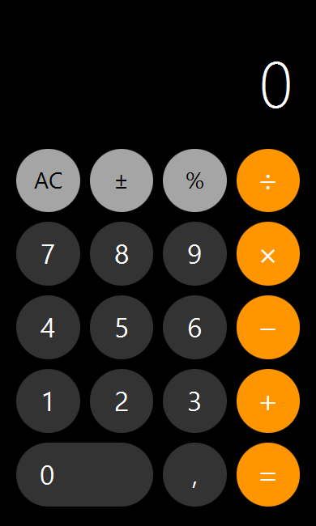

# Calculadora JavaFX

Calculadora desktop desenvolvida em Java, com interface inspirada no visual clássico da calculadora do iOS. Um projeto simples para praticar interfaces gráficas, eventos, controle de estado e operações com números decimais.

<p align="center">
  
</p>

## Funcionalidades

- Soma, subtração, multiplicação e divisão.
- Entrada de números decimais com vírgula e inversão de sinal.
- Porcentagem: `200 + 10 % =` resulta em `220`.
- Operações encadeadas e repetição da última operação ao pressionar `=`.
- Limpeza com `AC` e exclusão do último dígito pelo teclado.
- Tratamento de divisão por zero, permitindo iniciar uma nova conta após o erro.
- Destaque do operador selecionado e ajuste do tamanho do texto no visor.

As operações são resolvidas na ordem em que são inseridas, como em uma calculadora básica: `2 + 3 × 4 =` resulta em `20`. A entrada aceita até 14 dígitos e os cálculos usam precisão de 14 algarismos significativos.

## Tecnologias

- Java — projeto compilado e verificado com JDK 25.
- JavaFX 25.0.5 — interface gráfica.
- CSS — estilos dos componentes JavaFX.
- `BigDecimal` — cálculos decimais usados pela interface.
- IntelliJ IDEA — configuração de projeto incluída no repositório.

## Como executar

O projeto usa o JavaFX SDK instalado localmente, sem Maven ou Gradle.

1. Instale o JDK 25 e o JavaFX SDK 25.0.5 compatível com seu sistema.
2. Abra a pasta do projeto no IntelliJ IDEA.
3. Em **File > Project Structure > Project**, selecione o JDK 25.
4. Em **Project Structure > Libraries**, ajuste a biblioteca `lib` para apontar para a pasta `lib` do seu JavaFX SDK. O caminho salvo no projeto pertence ao ambiente de desenvolvimento original.
5. Crie uma configuração do tipo **Application**, com a classe principal `com.jota.calculadoraIOS.Main` e o classpath do módulo `calculadoraIOS`.
6. Em **VM options**, adicione as opções abaixo, substituindo o caminho pelo local do seu SDK:

```text
--module-path "C:\caminho\javafx-sdk-25.0.5\lib" --add-modules javafx.controls --enable-native-access=javafx.graphics
```

7. Execute a classe `Main`.

## Atalhos

| Tecla | Ação |
| --- | --- |
| `0` a `9` | Inserir números |
| `,` ou `.` | Separador decimal |
| `+`, `-`, `*`, `/` | Operações básicas |
| `%` | Porcentagem |
| `Enter` ou `=` | Calcular |
| `Esc` ou `Delete` | Limpar tudo |
| `Backspace` | Apagar o último dígito durante a entrada |

## Organização

```text
src/com/jota/calculadoraIOS/
├── Main.java                    # Inicialização da aplicação
├── model/
│   ├── Calculadora.java          # Classe inicial de operações com double
│   └── CalculadoraEstado.java    # Estado e cálculos usados pela interface
└── view/
    ├── CalculadoraView.java     # Componentes e eventos da interface
    └── styles.css               # Aparência da calculadora

tests/
└── CalculadoraEstadoTest.java    # Verificações da lógica, sem JavaFX
```

A lógica de estado está separada dos componentes JavaFX. Nesta versão, a view também recebe os eventos dos botões e do teclado; ainda não existe um controller separado.

## Testes

Há 22 cenários de teste para operações básicas, decimais, porcentagem, troca de operador, contas encadeadas, limpeza, limite de entrada e recuperação após erros.

Para executar no PowerShell, na raiz do projeto, com `javac` e `java` do JDK 25 disponíveis no PATH:

```powershell
New-Item -ItemType Directory -Force out/tests | Out-Null
javac -encoding UTF-8 -d out/tests src/com/jota/calculadoraIOS/model/CalculadoraEstado.java tests/CalculadoraEstadoTest.java
java -cp out/tests CalculadoraEstadoTest
```

Saída esperada: `22 testes passaram.`

## Próximas melhorias

- Extrair o tratamento de eventos para uma camada controller.
- Configurar Maven ou Gradle para facilitar a instalação das dependências.
- Adicionar um histórico de operações.

---

Projeto de estudo inspirado na interface do iOS, sem vínculo com a Apple.
